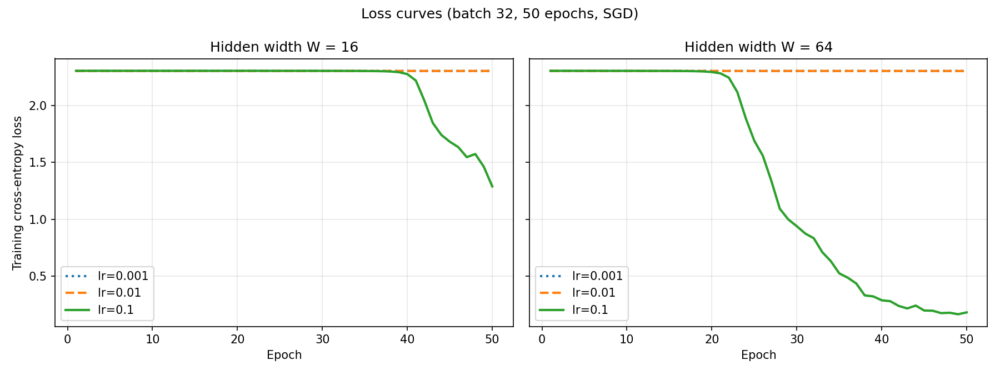

# Lab 2: A neural network from scratch

## Goal

Build a two-hidden-layer neural network in pure NumPy (no deep-learning framework), implement forward propagation, cross-entropy loss and backpropagation by hand, verify the gradients numerically, train it on `load_digits`, and measure how long the forward and backward passes take.

## Method

- **Environment:** same `.venv` as Lab 1 (Python 3.11.8, pinned `requirements.txt`). CPU only: Intel Core i7-8750H, 16 GB RAM, Windows 10.
- **Data:** `load_digits` (1,797 images of 8×8 pixels, 10 classes). Inputs divided by 16 to scale to [0, 1], labels one-hot encoded. Stratified 70/30 split with `random_state=42` gives 1,257 train and 540 test samples.
- **Seeds:** `random`, `numpy` and `torch` seeded with 42. NumPy `default_rng(42)` is used for initialisation and shuffling.
- **Architecture:** 64 → W → ReLU → W → ReLU → 10 → softmax, with W = 16 and W = 64.

| Layer | Weight shape | Bias shape |
|---|---|---|
| Hidden 1 | (64, W) | (W,) |
| Hidden 2 | (W, W) | (W,) |
| Output | (W, 10) | (10,) |

  - Weights are drawn from N(0, 0.01), i.e. std = 0.01, and biases start at 0.
  - Total parameters: 1,482 for W = 16 and 8,970 for W = 64.
- **Gradients (chain rule):**
  - softmax + cross-entropy: `dL/dz3 = (p − y) / batch`
  - linear layer `z = a·W + b`: `dL/dW = aᵀ·dz`, `dL/db = Σ dz`, `dL/da = dz·Wᵀ`
  - ReLU: `dL/dz = dL/da · 1[z > 0]`
- **Gradient check:**
  - 10 random weights, central difference with ε = 1e-5.
  - Relative error = |analytic − numeric| / (|analytic| + |numeric|).
  - Pass condition: error < 1e-6 for at least 9 of 10 weights.
  - The check is done after 50 epochs of training (lr = 0.1). At the N(0, 0.01) initialisation many gradients are only about 1e-7, so float64 round-off in the numerical slope alone produced relative errors around 1e-5, and only 6–7 of 10 weights passed even though the code is correct.
- **Training:** mini-batch SGD with batch size 32, data shuffled every epoch, 50 epochs. Grid of learning rates {0.001, 0.01, 0.1} × widths {16, 64}.
- **Timing:** forward and backward timed separately; 1 warm-up, then 100 runs, median reported. Batch sizes 32 and 1,257 (the full train set). Matmul FLOPs counted as 2·m·k·n per product: 3 matmuls in forward, 5 in backward.

## Results

### Sanity checks (`results/checks.txt`)

| Check | W = 16 | W = 64 |
|---|---|---|
| Output shape | (32, 10) ✅ | (32, 10) ✅ |
| Max \|row sum − 1\| | 3.3e-16 ✅ | 3.3e-16 ✅ |
| Untrained loss (ln 10 = 2.3026) | 2.3026 ✅ | 2.3026 ✅ |
| Gradient check | 10/10 PASS | 10/10 PASS |

### Training (`results/loss_curves.png`, `results/final_accuracy.csv`)

| Width | LR | Final train loss | Final test loss | Test accuracy |
|---|---|---|---|---|
| 16 | 0.001 | 2.3026 | 2.3025 | 0.1019 |
| 16 | 0.01 | 2.3027 | 2.3025 | 0.1019 |
| 16 | 0.1 | 1.2883 |