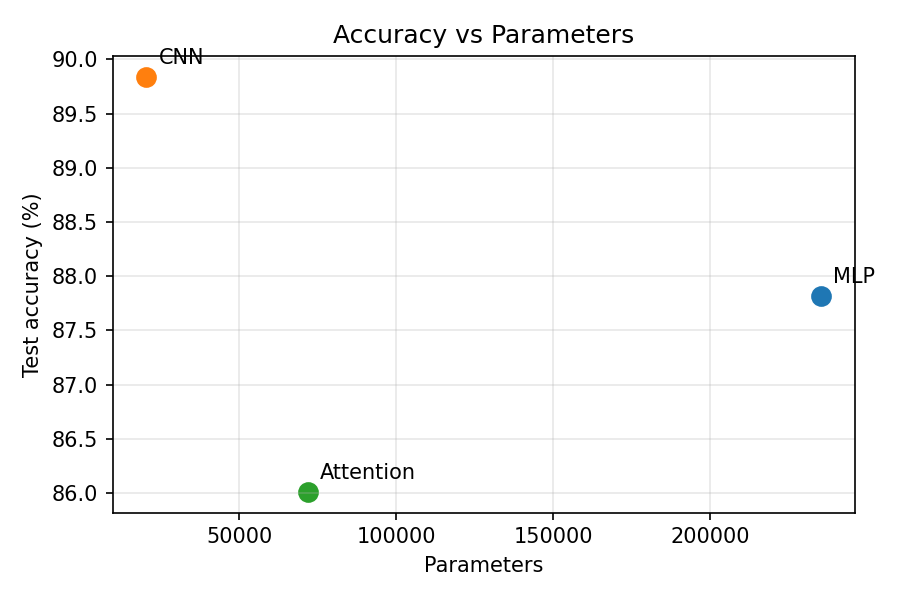
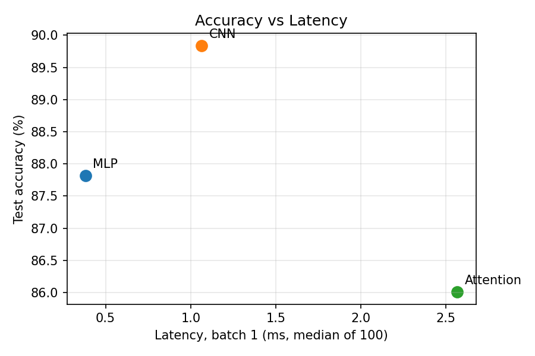

# Lab 3: Architectures and their costs

Dataset: Fashion-MNIST, `ToTensor()` + `Normalize((0.2860,), (0.3530,))`, 55k train / 5k val / 10k test, batch 128.
Training: 5 epochs, Adam, lr 1e-3. Latency measured on CPU, median of 100 runs (batch 1) and 20 runs (batch 128), after 10 warm-up runs.

## 1. Models

| Model | Architecture |
|---|---|
| MLP | Flatten 784 → Linear 256 → ReLU → Linear 128 → ReLU → Linear 10 |
| CNN | Conv(1,16,3,p1) → ReLU → MaxPool2 → Conv(16,32,3,p1) → ReLU → MaxPool2 → Flatten → Linear(1568,10) |
| Attention | 16 patches of 7×7 → Linear(49,64) + learned pos. embedding → 2× TransformerEncoderLayer(d=64, h=4, ff=128) → mean pool → Linear(64,10) |

Note: with the architectures exactly as specified, parameter counts are MLP ≈ 235k, CNN ≈ 20k, Attention ≈ 72k, so only the order of magnitude matches the 100k–150k target. The specified layers were kept unchanged so results are comparable with the lab manual.

## 2. Results

| Model | Params (torchinfo) | Test acc | Latency b=1 (ms) | Latency b=128 (ms) | Per-sample @128 (ms) |
|---|---|---|---|---|---|
| MLP | 235,146 | 87.82% | 0.382 | 1.280 | 0.0100 |
| CNN | 20,490 | 89.84% | 1.064 | 22.712 | 0.1774 |
| Attention | 71,818 | 86.01% | 2.567 | 15.941 | 0.1245 |

## 3. FLOPs: hand calculation vs thop

### One representative layer per model

Formulas (Ch. 4): Linear `2·in·out`, Conv2d `2·K·K·C_in·C_out·H_out·W_out`, Attention `2·seq·d·3d` (QKV) + `2·seq²·d` (scores) + `2·seq²·d` (A·V) + `2·seq·d·d` (out proj) + FFN.

| Model | Layer | Hand FLOPs | thop MACs | thop ×2 (FLOPs) |
|---|---|---|---|---|
| MLP | Linear(784,256) | 401,408 | 200,704 | 401,408 |
| CNN | Conv2d(16,32,3) on 14x14 | 1,806,336 | 903,168 | 1,806,336 |
| Attention | 1 TransformerEncoderLayer (seq=16, d=64) | 1,114,112 | 0 | 0 |

Attention layer breakdown (seq=16, d_model=64, ff=128):

| Term | FLOPs |
|---|---|
| QKV projections 2*seq*d*3d | 393,216 |
| Scores QK^T 2*seq^2*d | 32,768 |
| Weighted sum AV 2*seq^2*d | 32,768 |
| Output proj 2*seq*d*d | 131,072 |
| FFN 2*seq*(d*ff + ff*d) | 524,288 |
| **Total** | **1,114,112** |

### Whole model (batch 1)

| Model | Hand FLOPs | thop MACs ×2 | torchinfo mult-adds ×2 |
|---|---|---|---|
| MLP | 469,504 | 469,504 | 470,292 |
| CNN | 2,063,488 | 2,063,488 | 2,101,140 |
| Attention | 2,329,856 | 101,632 | 7,700 |

### Explaining the gap

- **MACs vs FLOPs.** thop reports multiply-accumulate operations. One MAC = 2 FLOPs, so thop numbers must be doubled before comparing with the Ch. 4 formulas. After doubling, Linear and Conv2d match almost exactly; the small remainder is bias additions and the elementwise ops (ReLU, MaxPool) that thop counts but the formulas ignore.
- **Attention is undercounted by thop.** thop only has hooks for standard modules (`nn.Linear`, `nn.Conv2d`, …). The Q·Kᵀ and A·V matrix products, softmax and the fused projections inside `nn.MultiheadAttention` / `TransformerEncoderLayer` run as functional calls (`F.multi_head_attention_forward` / scaled-dot-product attention) with no registered hook, so they are partly or completely missing from the thop total. This is why the attention model shows the largest gap between hand and measured FLOPs.
- **Ignored ops in hand counts.** LayerNorm, softmax, GELU/ReLU, pooling and the positional embedding add are not in the formulas; they are small in FLOPs but not free in time (they are memory-bound).

## 4. Trade-off plots





## 5. Which architecture is most cost-effective? (Ch. 4.6–4.7 access patterns)

- Highest accuracy: **CNN** (89.84%).
- Best accuracy per parameter: **CNN**.
- Lowest batch-1 latency: **MLP** (0.382 ms).

**MLP – dense, streaming access.** Every input pixel is connected to every hidden unit, so the weight matrix (≈ 235k params, ~0.9 MB in fp32) must be read for every sample. At batch 1 it is a matrix-vector product: each weight is used once, arithmetic intensity is ~1 FLOP/byte, so it is memory-bandwidth bound. It is still fast here because the whole model fits in cache and there are only three kernel launches. It has no spatial inductive bias, so it spends most parameters on the first layer and gets the lowest accuracy per FLOP.

**CNN – local, reused access.** A 3×3 kernel is reused at every spatial position (weight sharing), so the CNN has ~10× fewer parameters than the MLP yet the most FLOPs. High reuse means high arithmetic intensity: weights stay in cache/registers and the computation is compute-bound rather than memory-bound, which is the regime hardware is best at. The sliding-window (im2col / Winograd) access pattern is regular and sequential. Locality matches the structure of images, which is why it reaches the best accuracy with the fewest parameters.

**Attention – global, dynamic access.** Each patch token attends to all 16 tokens, so the attention matrix is O(seq²) and its weights are computed at run time (data-dependent), not stored. With seq=16 the quadratic term is tiny, but the model performs many small, separate ops (QKV projection, reshape/transposes for heads, softmax, LayerNorm, residual adds, FFN). These are memory-bound, have low arithmetic intensity and each costs a kernel launch, so latency is dominated by overhead rather than FLOPs, especially at batch 1. Batching to 128 amortises this overhead (compare the per-sample column). Without the strong spatial prior of convolution and with only 5 epochs, it does not beat the CNN in accuracy.

**Conclusion.** For this task the **CNN** is the most cost-effective architecture: it has the fewest parameters (smallest memory footprint and bandwidth requirement) and its compute-bound, high-reuse access pattern turns its FLOPs into accuracy efficiently. The MLP is cheap in latency but parameter-heavy and less accurate; the attention model pays latency for many small memory-bound operations without an accuracy benefit at this scale.

## Reproduce

```
pip install -r requirements.txt
python lab03.py
```
