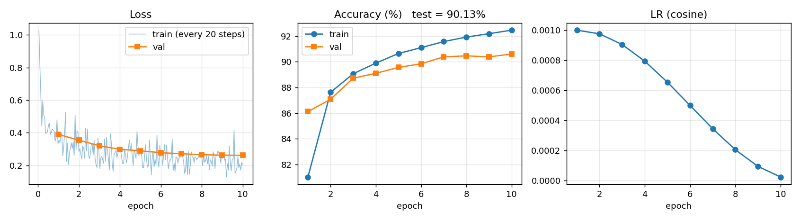
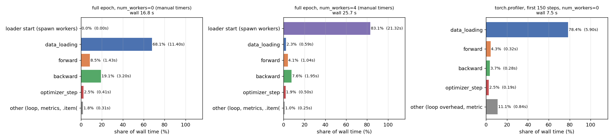
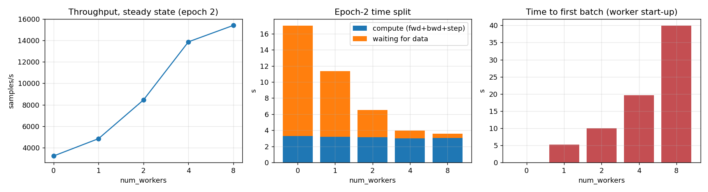
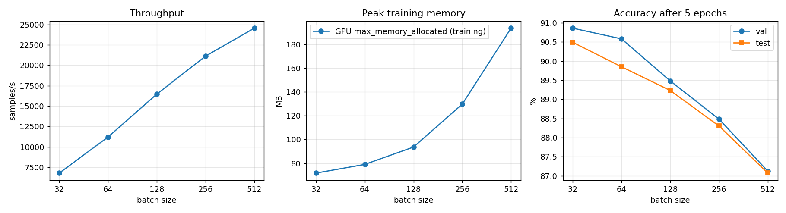
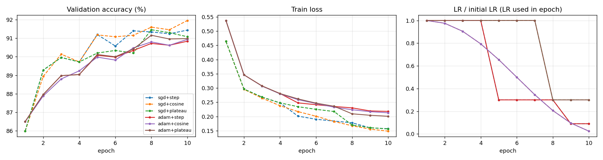
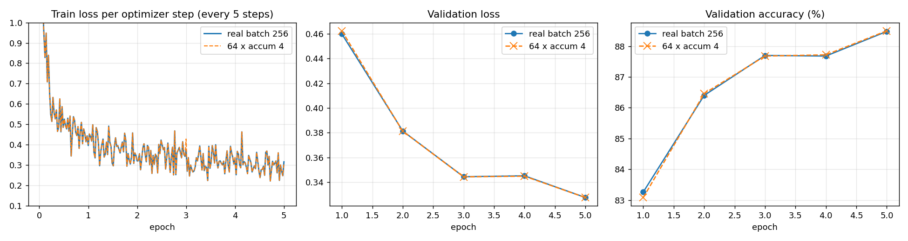
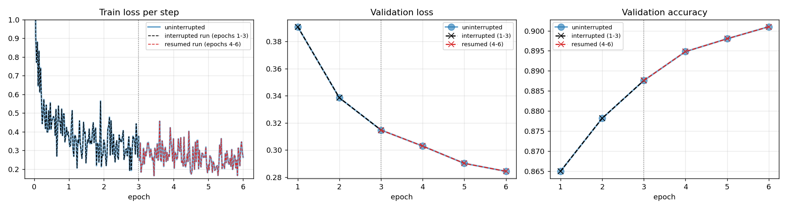

# Lab 6: Training pipelines and project proposal

Veniamin Vyrovyi, ID 72348. The model is the **best model from Lab 3**: a small CNN (Conv 1→16 → pool → Conv 16→32 → pool → Linear 1568→10, **20,490 parameters**, 89.84% test accuracy in Lab 3). It is trained on **Fashion-MNIST** with the same 55k / 5k / 10k split (seed 42) and the same normalisation.

Every number below comes from a run saved in `results/` (`results/runs/<run>/history.csv`, `steps.csv` and `summary.json`). The tables are produced by `src/studies.py` from those files.

## Hardware

| | |
|---|---|
| CPU | Intel Core i7-8750H, 6 cores / 12 threads, 2.2 GHz (PyTorch uses 6 intra-op threads) |
| RAM | 15.9 GB |
| GPU | NVIDIA GeForce GTX 1050 Ti, 4 GB (driver 581.08) |
| Software | Windows 10 (19045), Python 3.11.8, PyTorch 2.3.1 + CUDA 12.1, MLflow 2.14.1 |

All runs use the GPU except the 10-epoch base run. That run was made first, on the CPU-only PyTorch wheel the repository used until then (see Assumptions).

## Files

| Path | What |
|---|---|
| `configs/base.yaml` | **the single config**: seed, data, model, optimiser, scheduler, training, checkpoint, MLflow, profiler |
| `configs/study_*.yaml` | each study is a list of `--set key=value` overrides of `base.yaml` |
| `src/train.py` | the one training script (every experiment runs through it) |
| `src/studies.py` | runs a study (one `train.py` **process per experiment**, skipping finished ones), then builds the tables and plots |
| `results/*.csv`, `results/*.png` | study tables and plots (used below) |
| `results/runs/<run>/` | per-run `history.csv` (per epoch), `steps.csv` (per optimizer step), `summary.json`, profiler tables |
| `results/wallclock.csv` | raw log of every launched run, **including failed attempts** (see "What went wrong") |
| `PROPOSAL.md` | task 8: individual project proposal |
| `mlruns/`, `checkpoints/`, `outputs/` | MLflow store, checkpoints, per-run plots (git-ignored, regenerated by the commands below) |

## How to reproduce

```bash
.venv\Scripts\activate
pip install -r requirements.txt
pip install torch==2.3.1+cu121 torchvision==0.18.1+cu121 --index-url https://download.pytorch.org/whl/cu121  # GPU build
python lab06/src/train.py --config lab06/configs/base.yaml             # task 1: one run from the config
python lab06/src/studies.py all                                          # tasks 2-7 (base run + all studies)
python lab06/src/studies.py batch_size                                   # ...or a single study
python lab06/src/studies.py all --analyze-only                           # rebuild tables/plots only
mlflow ui --backend-store-uri lab06/mlruns                               # browse runs at http://127.0.0.1:5000
```

The runner is resume-safe: an experiment whose `summary.json` already exists is skipped (delete `results/runs/<run>/` to redo it). A memory watchdog kills any run that uses more than about 6 GB of extra system RAM or leaves less than 1 GB free. On this laptop, all studies except the CPU base run took **about 26 minutes of wall time** (sum of the final successful runs in `wallclock.csv`).

---

## Task 1: config-driven pipeline with checkpoints and MLflow

`train.py` takes `--config base.yaml` plus any number of `--set section.key=value` overrides. The value is parsed as YAML, and a misspelt key raises an error. Each study config only lists overrides, so all experiments run the same code.

- **Seeds and determinism.** `random`, `numpy` and `torch` (CPU and CUDA) are seeded, cuDNN runs in deterministic mode and `torch.use_deterministic_algorithms(True)` is on. The shuffle order of each epoch comes from a generator re-seeded with `seed + epoch`. Data order therefore depends only on (seed, epoch) and not on what happened before. This is what makes resume exact (task 7).
- **Checkpoint** (`checkpoints/<run>/last.pt`, saved every epoch): model, optimizer and scheduler `state_dict`s, epoch, global step, RNG state of python/numpy/torch/CUDA, the metric history, the config and the MLflow run id.
- **Resume**: `--set train.resume_from=<ckpt>` restores all of the above and **continues the same MLflow run**.
- **MLflow** (local file store `mlruns/`, experiment `lab06`, 24 runs):
  - params: the whole flattened config (44 params in the current version of `base.yaml`), plus the parameter count and device;
  - per-epoch metrics: train/val loss and accuracy, learning rate, epoch time, time per phase, throughput and peak memory;
  - final metric: test accuracy;
  - artifacts: the resolved `config.yaml`, the curves PNG, `history.csv`, the checkpoint, and the profiler table for the profiling run.

**Base run** (`configs/base.yaml`: Adam, lr 1e-3, cosine schedule, batch 128, 10 epochs). Run on CPU with the per-image pipeline:

| epoch | 1 | 2 | 3 | 4 | 5 | 6 | 7 | 8 | 9 | 10 |
|---|---|---|---|---|---|---|---|---|---|---|
| val acc (%) | 86.12 | 87.08 | 88.72 | 89.10 | 89.56 | 89.84 | 90.38 | 90.46 | 90.38 | 90.60 |

Test accuracy is **90.13%**, compared with 89.84% after 5 epochs in Lab 3. The extra epochs and the cosine schedule add 0.3 pp. Mean epoch time was 35.6 s on the CPU. Curves: `results/base_curves.png`.



## Task 2: profiling one epoch

The profiling runs use the **original per-image pipeline**: PIL image → `ToTensor` → `Normalize`, done per sample, `data.preload=false`. This makes the cost of data loading real.

**Main table: manual timers over the full epoch** (`time.perf_counter`, with `torch.cuda.synchronize()` before each reading, so that GPU work asynchronously queued in one phase is not billed to the next). Batch 128, 430 steps, GPU.

| Phase | num_workers=0: time (s) | share | num_workers=4: time (s) | share |
|---|---|---|---|---|
| loader start (spawn workers) | 0.00 | 0.0% | 21.32 | 83.1% |
| **data loading** (wait for `next(loader)` + `.to(device)`) | **11.40** | **68.1%** | 0.59 | 2.3% |
| forward | 1.43 | 8.5% | 1.04 | 4.1% |
| backward | 3.20 | 19.1% | 1.95 | 7.6% |
| optimizer step (+ zero_grad) | 0.41 | 2.5% | 0.50 | 1.9% |
| other (loop, metrics, `.item()`) | 0.31 | 1.8% | 0.25 | 1.0% |
| **epoch** | **16.75** | 100% | **25.65** (4.33 without start-up) | 100% |

Source: `results/profile_breakdown.csv`.

**Evidence: torch.profiler with `record_function` labels on the first 150 steps** (`record_shapes=False`, `profile_memory=False`, `with_stack=False`, CPU activity). The labels in `train.py` are `data_loading`, `forward`, `backward` and `optimizer_step`. Sources: `results/torchprof_breakdown_150steps.csv` and `torchprof_top_ops_150steps.csv`.

| Label | Time (s) | Share of 7.5 s |
|---|---|---|
| data_loading | 5.90 | 78.4% |
| forward | 0.32 | 4.3% |
| backward | 0.28 | 3.7% |
| optimizer_step | 0.19 | 2.5% |
| other (incl. profiler overhead) | 0.84 | 11.1% |

The top operators by self time are:

- the DataLoader `__next__` itself, at 49%;
- then thousands of tiny per-image ops: `aten::_to_copy` (58,050 calls), `aten::div` (19,500), `aten::eq` and `aten::any` (19,200 each), `aten::sub_`, `aten::permute` (19,200 each).

19,200 = 150 steps × 128 images: each of these ops runs **once per image**. These are `ToTensor` (uint8→float, permute, divide by 255) and `Normalize` (checks `std == 0`, then subtracts and divides). The convolution kernels (`cudnn_convolution`, 300 calls) take only 2.4%.



**Why.** The model is tiny: about 1 MFLOP per image, so a batch costs a few milliseconds of GPU time. The input pipeline, by contrast, makes a Python call chain per image: PIL decode, about 6 small tensor ops, and collating 128 tensors. All of it runs in the main Python thread, while the GPU sits idle. Data loading is therefore **68–78% of the epoch: the job is input-bound, not compute-bound.** Backward costs about 2× the forward pass, as expected (gradients with respect to both activations and weights). The optimizer step is small because there are only 20k parameters. With 4 workers the steady-state data wait drops to 0.6 s, but starting 4 worker processes on Windows costs 21 s (task 3).

**Why the profiler covers only 150 steps.** A full-epoch torch.profiler trace of this pipeline records millions of events (about 15 per image). On this 16 GB laptop it exhausted RAM: the first attempt was killed. Even 150 steps reached 4.7 GB of process memory. The full-epoch table therefore comes from the cheap manual timers, and the profiler is used only for operator-level evidence. Both agree that data loading is 68–78% of the epoch.

## Task 3: num_workers

Per-image pipeline, batch 128, 2 epochs, `persistent_workers=True`. Epoch 1 includes starting the workers; epoch 2 is the steady state. Evaluation loads data in the main process. Source: `results/num_workers.csv`.

| num_workers | time to 1st batch (s) | epoch 1 (s) | epoch 2 (s) | throughput, epoch 2 (samples/s) | data wait, epoch 2 | compute, epoch 2 (s) | speed-up | peak RSS (all processes, MB) |
|---|---|---|---|---|---|---|---|---|
| 0 | 0.04 | 16.3 | 17.0 | 3,235 | 13.7 s (81%) | 3.30 | 1.00× | 955 |
| 1 | 5.3 | 16.8 | 11.3 | 4,848 | 8.2 s (72%) | 3.18 | 1.50× | 1,458 |
| 2 | 9.9 | 16.6 | 6.5 | 8,454 | 3.4 s (52%) | 3.14 | 2.61× | 1,964 |
| 4 | 19.7 | 23.8 | 4.0 | 13,869 | 0.9 s (24%) | 3.02 | 4.29× | 2,963 |
| 8 | 39.9 | 43.8 | 3.6 | 15,401 | 0.5 s (14%) | 3.05 | 4.76× | 4,907 |



**Bottleneck.** With 0 workers, 81% of the epoch is spent waiting for data. The "compute" column (forward + backward + step) is about 3.1 s for every setting: the GPU work is fixed, and only the wait changes.

- **More workers** decode images in parallel, so the wait falls almost in proportion: 13.7 → 8.2 → 3.4 → 0.9 s for 0, 1, 2 and 4 workers.
- **At 4–8 workers** the wait is nearly gone. The epoch (3.6 s) is now close to the compute floor (3.05 s), so the bottleneck has **moved from data loading to the training step itself.** Going from 4 to 8 workers gains only 11%. Beyond that point the remaining cost is the main process collating batches, copying them to the GPU and launching kernels. More decoders cannot help with that, and 8 workers plus 6 PyTorch threads also oversubscribe the 6 physical cores.
- **The cost is start-up and memory.** On Windows, workers are *spawned*, not forked: every worker starts a fresh Python, re-imports torch, which loads the CUDA DLLs, and unpickles the dataset. That takes about 5 s per worker, one after another (first batch after 40 s with 8 workers), and about 0.5 GB RSS each. With 8 workers, the 2-epoch run (47 s) is *slower* than with 0 workers (33 s). Workers pay off only for long runs with `persistent_workers=True`.

The best setting for this machine is **4 workers**: 4.3× the throughput for 3 GB RAM. Even better is to remove the per-image work altogether. Every other experiment in this lab preloads the dataset as normalised tensors once (`data.preload=true`), which makes data loading about 8% of a 3.3 s epoch (`bs_128`: 7.7–8.9% per epoch).

## Task 4: batch size

GPU, preloaded data, Adam with lr 1e-3 and cosine schedule, **5 epochs**, the same learning rate for every batch size. Source: `results/batch_size.csv`.

| batch | steps/epoch | throughput (samples/s) | epoch (s) | peak GPU memory, training (MB) | process RSS (MB) | val acc ep5 | test acc ep5 |
|---|---|---|---|---|---|---|---|
| 32 | 1719 | 6,800 | 8.09 | 71.7 | 1,118 | 90.86% | 90.49% |
| 64 | 860 | 11,213 | 4.91 | 79.0 | 1,119 | 90.58% | 89.85% |
| 128 | 430 | 16,464 | 3.35 | 93.6 | 1,119 | 89.48% | 89.23% |
| 256 | 215 | 21,114 | 2.61 | 129.7 | 1,134 | 88.48% | 88.30% |
| 512 | 108 | 24,535 | 2.25 | 193.6 | 1,132 | 87.12% | 87.07% |

GPU memory is `torch.cuda.max_memory_allocated()`, reset at the start of each training epoch, so evaluation at batch 512 does not mask the signal.



- **Throughput rises 3.6× but saturates.** Each step has a fixed cost: Python loop, about 10 kernel launches, `.item()` syncs and the optimizer step. For a 20k-parameter model that overhead is larger than the arithmetic. Bigger batches spread it over more samples. The gain shrinks (+65%, +47%, +28%, +16% per doubling) once the GPU is actually busy.
- **Memory grows linearly with batch size.** Weights and Adam state are tiny (20,490 × 4 B × 3 ≈ 0.25 MB). The about 65 MB floor is the CUDA/cuDNN workspace and the caching allocator. The slope, (193.6 − 71.7) / 480 ≈ **0.25 MB per extra sample**, is the activations saved for backward: conv outputs 16×28×28 and 32×14×14, ReLU masks, pooled maps and their gradients. Process RSS stays at about 1.1 GB, which is mostly the CUDA context and libraries.
- **Accuracy falls as batch size grows at a fixed epoch budget and learning rate.** Batch 512 makes 16× fewer parameter updates than batch 32 (540 vs 8,595 in 5 epochs) with the same step size, so it is simply less trained: final train loss 0.342 vs 0.206. Small batches also add gradient noise, which acts as a regulariser. To use a large batch without losing accuracy one would raise the learning rate (the linear scaling rule) and add warm-up. This is a trade-off: **batch 128–256 is the efficiency sweet spot** on this GPU, 67–86% of the maximum throughput while losing 1–2 pp after 5 epochs.

## Task 5: LR schedules and optimizers (equal 10-epoch budget)

Batch 128, preloaded data. SGD uses momentum 0.9 and lr 0.05; Adam uses lr 1e-3, the standard default for each. Schedules:

- **StepLR**: ×0.3 every 4 epochs;
- **Cosine**: T_max = 10 epochs;
- **ReduceLROnPlateau**: on validation loss, factor 0.3, patience 1.

Source: `results/schedules.csv`.

| optimizer | schedule | final val acc | best val acc | **test acc** | final train loss | LR in last epoch |
|---|---|---|---|---|---|---|
| SGD+momentum | StepLR | 91.44% | 91.44% | 90.99% | 0.157 | 0.0045 |
| SGD+momentum | **Cosine** | **91.96%** | **91.96%** | **91.31%** | **0.149** | 0.0012 |
| SGD+momentum | Plateau | 91.08% | 91.46% | 91.00% | 0.156 | 0.0150 |
| Adam | StepLR | 90.84% | 90.84% | 90.20% | 0.218 | 0.00009 |
| Adam | Cosine | 90.94% | 90.94% | 90.20% | 0.213 | 0.00002 |
| Adam | Plateau | 90.98% | 91.16% | 90.26% | 0.201 | 0.0003 |



- **The best result is SGD + cosine (91.31% test).** Cosine keeps the LR high for most of training, so the model makes fast progress and escapes poor regions. It then decays smoothly to almost 0, so the last epochs settle into a minimum. Validation accuracy rises in every one of the last 4 epochs (91.2 → 91.6 → 91.5 → 92.0).
- **StepLR** does the same in two jumps. Each drop gives a visible gain (epoch 5: 89.7 → 91.2), but after the last drop there is little left to anneal.
- **ReduceLROnPlateau** waited too long. Validation loss kept improving slightly, so the LR was reduced only once, at epoch 8, and the run ended at a still-high 0.015. It reached its best validation accuracy (91.46%) at epoch 8, then oscillated. Reacting to noise in a 5k validation set is its weakness when the budget is short.
- **SGD beats Adam by about 1 pp here.** Adam reaches a *higher* final train loss (0.20–0.22 vs 0.15), so it is not overfitting; it is less optimised. With lr 1e-3, Adam's per-parameter step is small. SGD at 0.05 with momentum takes larger effective steps on this well-conditioned small CNN, and it is also known to generalise slightly better on vision tasks. Adam's advantage is robustness: it reached 86.5% after epoch 1, versus 86.0% for SGD, without any tuning.
- **Caveat.** Each configuration is a single seed. Differences of 0.1–0.3 pp between schedules with the same optimizer are within noise: one standard error on the 10k test set is about 0.3 pp. The SGD-vs-Adam gap of about 1 pp holds consistently across all three schedules.

## Task 6: gradient accumulation (64 × 4 vs real 256)

Both runs use the same seed, so they see the same shuffled order. Consecutive groups of 4 micro-batches of 64 contain exactly the samples of one real batch of 256. Each micro-batch loss is divided by the group size before `backward()`; gradients add up in `.grad`, and the optimizer steps once per group. Both runs make 215 optimizer steps per epoch. Source: `results/grad_accum.csv`, `grad_accum_diff.csv`.

| run | final train loss | final val loss | final val acc | test acc | throughput (samples/s) | peak GPU memory (training) |
|---|---|---|---|---|---|---|
| real batch 256 | 0.29869 | 0.32762 | 88.48% | 88.30% | 20,845 | 129.7 MB |
| batch 64 × accumulate 4 | 0.29865 | 0.32757 | 88.50% | 88.27% | 12,543 | 79.0 MB |

Mean absolute difference of the per-step loss is **0.00056**. The largest difference in validation accuracy at any epoch is 0.18 pp, at epoch 1.



**The two runs behave the same.** The curves overlap, and the final metrics differ only in the 4th decimal, because the gradient of a mean over 256 samples equals the average of 4 means over 64. The small differences have two causes:

- **The last group of each epoch is not equivalent.** 55,000 = 859×64 + 24, so it holds micro-batches of 64, 64, 64 and 24 samples. Accumulation weights each micro-batch ¼, so the 24 samples count as much as 64, while the real batch of 216 weights every sample equally. The per-step loss logs confirm it: the only notable differences are at steps 215, 430, 645, 860 and 1075, exactly the epoch ends.
- **Floating-point summation order differs** (4 partial sums instead of 1), giving differences around 1e-7 that grow slightly over 1,000 steps.

**Trade-off.** Accumulation reached the same model with **39% less GPU memory** (activations for 64 samples instead of 256) but **40% lower throughput**: 4× more, smaller kernel launches per update. It is the tool for when a batch does not fit in memory, not a speed-up.

## Task 7: interrupt at epoch 3 and resume

Both runs use Adam with a cosine schedule over 6 epochs, so a wrongly restored scheduler or optimizer would show up as a jump in the curves.

- **`resume_full`**: 6 epochs, uninterrupted.
- **`resume_split`**: first run with `train.stop_after_epoch=3`. The process saves its checkpoint after epoch 3 and **exits**. A **new process** then runs with `train.resume_from=checkpoints/resume_split/last.pt` and continues epochs 4–6 in the same MLflow run.

Source: `results/resume.csv`.

| epoch | val acc, full | val acc, interrupted + resumed | abs. diff in train loss / val loss / val acc / lr |
|---|---|---|---|
| 1 | 86.50% | 86.50% | 0 / 0 / 0 / 0 |
| 2 | 87.82% | 87.82% | 0 / 0 / 0 / 0 |
| 3 | 88.76% | 88.76% | 0 / 0 / 0 / 0 |
| 4 (resumed) | 89.48% | 89.48% | 0 / 0 / 0 / 0 |
| 5 (resumed) | 89.80% | 89.80% | 0 / 0 / 0 / 0 |
| 6 (resumed) | 90.10% | 90.10% | 0 / 0 / 0 / 0 |



**The resumed run is bit-for-bit identical to the uninterrupted one.** Every per-step loss and every epoch metric matches with a difference of exactly 0, and the curves continue across the restart without a jump. This works because the checkpoint restores *everything* that influences the next update:

- the weights;
- the Adam moment estimates (without them Adam would restart with zero momentum and take a different step);
- the cosine scheduler's position (otherwise the LR would jump back to 1e-3);
- the RNG states;
- data order, which depends only on (seed, epoch).

Deterministic cuDNN and deterministic algorithms remove the remaining randomness.

## Task 8: project proposal

See [`PROPOSAL.md`](PROPOSAL.md): *On-device Keyword Spotting under Tight Latency and Size Budgets*.

---

## What went wrong (and what was changed)

`results/wallclock.csv` keeps every attempt. The failed attempts and their fixes:

1. **The first full run was killed by the OS** for low memory while profiling a full epoch with torch.profiler. The profiling was redesigned: manual timers cover the full epoch, and torch.profiler covers 150 steps with CPU activity only. A first 150-step attempt with CUDA activity tracing reached 6 GB and was stopped by hand. Every run is now a separate process under a memory watchdog.
2. **num_workers=8 pushed free RAM down to 1.1 GB.** The evaluation loaders also used 8 persistent workers, so up to 24 processes each re-imported CUDA torch. Evaluation now loads data in the main process, and all runs with workers were re-run (peak RSS with 8 workers went from 8.6 to 4.9 GB).
3. **The resume phase crashed twice:**
   - `torch.load(map_location="cuda")` moved the saved CPU RNG state to the GPU. Checkpoints are now loaded to the CPU first.
   - The CSV writer did not handle a history containing columns added between the two phases.

   Both are fixed, and the whole resume study was re-run on the final code.
4. **The first batch-size memory column was wrong.** `max_memory_allocated` included evaluation at batch 512, giving an identical 114.8 MB for batches 32–128. The GPU peak is now reset per training epoch, and the batch-size and grad-accum studies were re-run.

## Assumptions

- **Model and data are the Lab 3 CNN and split.** The best Lab 3 model (highest accuracy and accuracy per parameter) is reused unchanged.
- **GPU via the CUDA wheel.** The laptop has a GTX 1050 Ti, but the venv had the CPU-only PyTorch wheel pinned for Labs 1–5. It was replaced with `torch==2.3.1+cu121` (same version), and `requirements.txt` documents this. The code detects CUDA and falls back to CPU.
- **The base run is from before the switch.** The 10-epoch base run was made on CPU with the per-image pipeline, before the switch to GPU and preloading, and was not repeated. Its accuracy is comparable; its timings are CPU timings. `base.yaml` now defaults to `data.preload=true`.
- **Preloading.** Fashion-MNIST is decoded and normalised once into tensors (`TensorDataset`, whole-batch indexing) for every study **except profiling and num_workers**, which must keep the per-image DataLoader so the data-loading cost is real. Preloading gives numerically the same inputs and the same shuffle order.
- **Epoch counts.** Base 10; batch 5 and schedules 10 (as specified); num_workers 2 (start-up + steady state); profiling 1; grad accumulation 5; resume 6 (interrupt at 3).
- **Optimiser settings.** SGD lr 0.05 / momentum 0.9 and Adam lr 1e-3 are standard defaults, not tuned per schedule. StepLR uses step 4 / γ 0.3; Plateau uses factor 0.3 / patience 1.
- **The interruption is simulated with `train.stop_after_epoch`.** It is a real process exit after the checkpoint is written, not a killed process mid-epoch. A crash mid-epoch would resume from the last completed epoch.
- **Timings vary between repeats.** They are single runs on a laptop and vary by about 10% between repeats (for example, data loading measured 11.4 s and 12.9 s in two identical runs). The conclusions rely only on differences much larger than that.
