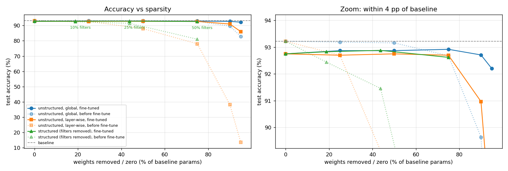
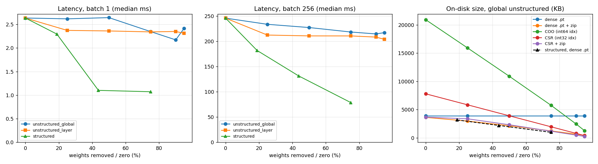
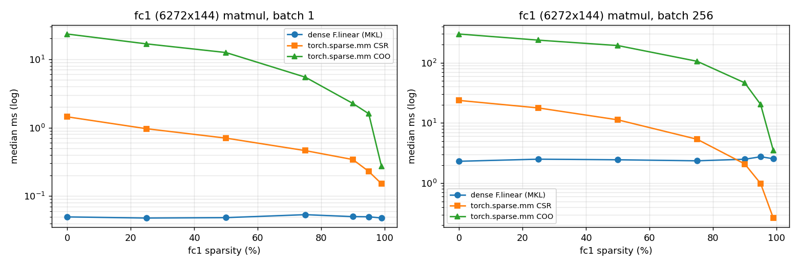
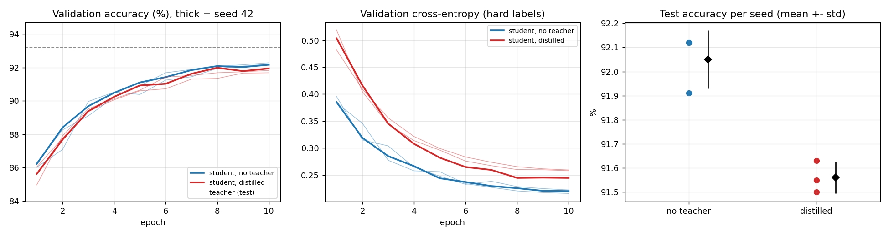
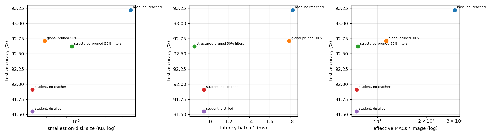

# Lab 7: Compression: pruning and distillation

Veniamin Vyrovyi, ID 72348. The dataset is **Fashion-MNIST** with the same 55k / 5k / 10k split (seed 42) and normalisation as Labs 3 and 6.

Every number below comes from a file in `results/` written by the scripts in `src/`. The full sequence of runs, including failed attempts, is in `results/runlog.csv`.

## Hardware

| | |
|---|---|
| CPU | Intel Core i7-8750H, 6 cores / 12 threads, 2.2 GHz |
| RAM | 15.9 GB |
| GPU | NVIDIA GeForce GTX 1050 Ti, 4 GB |
| Software | Windows 10 (19045), Python 3.11.8, PyTorch 2.3.1 + CUDA 12.1, codecarbon 2.4.2, thop |

- **Training** (baseline, fine-tuning, students) runs on the **GPU**, with the dataset preloaded as tensors in GPU memory.
- **Latency, on-disk size, sparse-kernel benchmarks and inference energy** are measured on the **CPU** with 6 threads. The CPU is the deployment target, and task 3 is specifically about dense CPU kernels.

## Files and how to reproduce

| Path | What |
|---|---|
| `configs/lab07.yaml` | all hyper-parameters (widths, epochs, sparsities, T, alpha, latency protocol, RSS limit) |
| `src/common.py` | data, model family `Net(widths)`, train loop (with mask or KD loss), latency / size / MACs / energy helpers |
| `src/baseline.py` | task 1 |
| `src/prune.py` | task 2 (`--variant <tag>` runs one variant, `--aggregate` builds the table and plot) |
| `src/latency_size.py`, `src/latency_interleaved.py` | task 3 |
| `src/distill.py` | task 4 (`--mode plain\|kd --seed N`, `--aggregate`) |
| `src/summary.py` | task 5 |
| `src/run_all.py` | runs every step above as a **separate process**, skips steps whose result file exists, watches RSS (kills a step above 6 GB), retries native crashes |
| `models/` | final small models (in git): `baseline.pt` 3.9 MB, `student_plain.pt` and `student_kd.pt` 0.4 MB each |
| `checkpoints/` | all pruned variants (git-ignored; regenerated by `prune.py`) |

```bash
.venv\Scripts\activate
pip install -r requirements.txt
pip install torch==2.3.1+cu121 torchvision==0.18.1+cu121 --index-url https://download.pytorch.org/whl/cu121
python lab07/src/run_all.py --dry-run    # plan + runtime estimate
python lab07/src/run_all.py              # everything (about 30 min on this laptop)
```

Total wall time of all Lab 7 steps, including failed attempts and re-runs, was **about 43 minutes** (`results/runlog.csv`).

---

## Task 1: oversized baseline (about 1M parameters)

`Net([32, 64, 128, 144])` has the following layers (shapes and parameter counts measured from the model):

- conv 1→32 (3×3), ReLU;
- conv 32→64, ReLU, max-pool to 14×14;
- conv 64→128, ReLU, max-pool to 7×7;
- fc 6272→144, ReLU;
- fc 144→10.

Training: Adam with lr 1e-3 and cosine schedule, batch 128, 8 epochs, seed 42.

| Metric | Value | Source |
|---|---|---|
| Parameters | **997,434** | `baseline.json` |
| Test accuracy | **93.22%** (val 93.68%) | `baseline.json` |
| On-disk size (`torch.save` state_dict) | 3,900 KB | `models/baseline.pt` |
| MACs per image | 30,031,776 (my per-layer count = thop) | `baseline.json` |
| CPU latency, batch 1 | **1.83 ms** (median) | `latency_interleaved.csv` |
| CPU latency, batch 256 | **184.7 ms** (median) | `latency_interleaved.csv` |
| Training time / energy | 87 s on GPU / 0.0025 kWh (estimate, see task 5) | `baseline.json` |

Latency protocol:

- **Sequential measurement** (`latency_size.py`): batch 1 uses 30 warm-up runs and the median of 300; batch 256 uses 5 warm-up runs and the median of 40.
- **Interleaved control** (`latency_interleaved.py`): 12 rounds; in every round each model gets 60 timed batch-1 runs and 4 batch-256 runs, in a rotated order, and the table reports the median over rounds.

**The model is "oversized" in an unbalanced way.** fc1 holds **903k of the 997k parameters (91%)** but performs only 0.9M of the 30M MACs (3%). The two 3×3 convolutions at 28×28 and 14×14 perform 14.5M MACs each (96% of the compute) with only 92k parameters. This split explains almost every pruning and latency result below: *parameters live in fc1, compute lives in the convolutions.*

Train accuracy reached 98.0% vs 93.7% validation. The model is big enough to memorise part of the training set.

## Task 2: magnitude pruning

- **Unstructured.** Weights of all conv and linear layers (not biases) are ranked by |w|.
  - **Global**: one threshold for all layers.
  - **Layer-wise**: each layer pruned to the same sparsity.

  The 0/1 mask is applied, then the model is fine-tuned for **3 epochs** with Adam (lr 3e-4) and the **mask fixed**: pruned weights are re-zeroed after every optimizer step, so they can never grow back.
- **Structured.** Whole conv filters and fc1 hidden units with the smallest L2 norm are removed (10%, 25% and 50% per layer). New, **physically smaller layers** are built: a removed filter also removes the matching input channel of the next conv, and the matching 49 input features of fc1. The smaller model is then fine-tuned for 3 epochs.

Source: `results/pruning.csv` and `pruning_layer_sparsity.csv`.

| variant | non-zero weights | % removed | test acc **before** FT | test acc **after** FT | drop vs baseline |
|---|---|---|---|---|---|
| baseline (no fine-tune) | 997,434 | 0 | – | 93.22% | – |
| dense control (sparsity 0, fine-tuned 3 epochs) | 997,434 | 0 | 93.22% | 92.75% | 0.47 pp |
| global 25% | 748,170 | 25.0 | 93.19% | 92.87% | 0.35 |
| global 50% | 498,906 | 50.0 | 93.16% | 92.87% | 0.35 |
| global 75% | 249,642 | 75.0 | 92.68% | **92.92%** | 0.30 |
| **global 90%** | 100,084 | 90.0 | 89.64% | **92.71%** | 0.51 |
| global 95% | 50,231 | 95.0 | 82.90% | 92.20% | 1.02 |
| layer-wise 25% | 748,170 | 25.0 | 92.70% | 92.70% | 0.52 |
| layer-wise 50% | 498,906 | 50.0 | 87.94% | 92.75% | 0.47 |
| layer-wise 75% | 249,642 | 75.0 | 78.03% | 92.70% | 0.52 |
| layer-wise 90% | 100,084 | 90.0 | 38.18% | 90.97% | 2.25 |
| layer-wise 95% | 50,230 | 95.0 | 13.60% | 86.02% | 7.20 |
| structured 10% filters (29-58-115-130) | 809,621 | 18.8 | 92.44% | 92.83% | 0.39 |
| structured 25% filters (24-48-96-108) | 561,454 | 43.7 | 91.46% | 92.88% | 0.34 |
| **structured 50% filters (16-32-64-72)** | 249,890 | 75.0 | 81.04% | **92.62%** | 0.60 |



What the curves show, and why:

- **Pruning 90% of the weights globally costs only 0.5 pp.** The network is heavily over-parameterised, so most weights are near zero and carry almost no signal. Even before fine-tuning, global 50% loses only 0.06 pp.
- **Fine-tuning recovers almost everything.** The remaining weights re-adapt to compensate for the removed ones: global 90% goes from 89.6% to 92.7%, and structured 50% from 81.0% to 92.6%.
- **Global beats layer-wise at high sparsity** (95%: 92.20% vs 86.02%). Global pruning removes weights where they are cheapest. `pruning_layer_sparsity.csv` shows that at global 95% the pruned share per layer is fc1 96.7%, conv3 81.9%, conv2 69.8% and **conv1 only 12.8%**. The small, critical layers are spared and the redundant fc1 takes the cut. Layer-wise pruning forces conv1, which has only 288 weights, to 95% as well, leaving 14 weights to extract all low-level features. That bottleneck cannot be fine-tuned away.
- **Structured pruning gives the same accuracy at the same parameter count.** At 75% of parameters removed: structured 50% reaches 92.62%, global 75% reaches 92.92%. Removing 50% of the filters removes 75% of the parameters, because a conv or fc layer shrinks in *both* its input and output dimension: (½)² = ¼ remain. Structured pruning is the less flexible method, since it must drop whole filters, so it is hit harder before fine-tuning (81.0% vs 92.7%). After fine-tuning the gap is only 0.3 pp.
- **Fine-tuning by itself costs about 0.5 pp.** The dense control (sparsity 0, 3 more epochs at a constant lr 3e-4) *lost* 0.47 pp, because the baseline had finished its cosine schedule at lr ≈ 0 and was already starting to overfit. Compared against this fair control, global pruning up to 75% is slightly *better* (92.87–92.92% vs 92.75%): removing weights acts as a mild regulariser. A shorter or lower-lr fine-tune would probably close the remaining gap to the baseline.

## Task 3: latency and on-disk size, honest analysis

### Latency (CPU, 6 threads)

Sequential measurement of every variant: `results/latency_size.csv`, plot `results/latency_size.png`. Because sequential numbers drifted between sessions (the baseline measured 2.64 ms, 2.47 ms and 2.00 ms in three different scripts), the key variants were **re-measured interleaved**: rotating rounds, so drift hits all models equally. Source: `results/latency_interleaved.csv`.

| model | non-zero weights | dense MACs | effective MACs | batch 1 (ms) | speed-up | batch 256 (ms) | speed-up |
|---|---|---|---|---|---|---|---|
| baseline | 997,434 | 30.0 M | 30.0 M | 1.825 | 1.00× | 184.7 | 1.00× |
| global-pruned 90% (masked) | 100,084 | 30.0 M | 11.3 M | 1.789 | **1.02×** | 188.7 | **0.98×** |
| global-pruned 95% (masked) | 50,231 | 30.0 M | 7.2 M | 1.923 | **0.95×** | 190.8 | **0.97×** |
| structured 50% (smaller layers) | 249,890 | 7.6 M | 7.6 M | 0.866 | **2.11×** | 75.2 | **2.46×** |
| student (100k, task 4) | 98,834 | 7.4 M | 7.4 M | 0.958 | 1.91× | 75.1 | 2.46× |

"Effective MACs" counts only non-zero weights: the work an ideal sparse kernel would do.



**Unstructured sparsity gave no speed-up at all.** With 90% or 95% of the weights set to zero, latency is within ±5% of the dense model, which is measurement noise in both directions. Only the physically smaller structured model is faster (2.1–2.5×). The reasons:

1. **A zero is still a number.** Masking only writes 0.0 into the same dense tensor. `nn.Conv2d` and `nn.Linear` still call the same dense oneDNN/MKL kernels with the same shapes. They multiply by zero exactly as fast as by any other number, so dense MACs remain 30.0M. The 11.3M "effective MACs" exist only on paper.
2. **The sparsity is in the wrong place.** Global pruning removes mostly fc1 weights (96.7% of fc1 at 95% sparsity), but fc1 is only 3% of the compute. A perfect sparse fc1 kernel could save at most about 3% of the latency. The convolutions, 96% of the MACs, are pruned much less, and PyTorch has no sparse convolution kernel on CPU at all.
3. **Sparse kernels have a high break-even point.** The micro-benchmark below replaces the dense fc1 matmul (6272×144) by `torch.sparse.mm` with the same weights in CSR or COO format. Source: `results/sparse_matmul.csv`.

| fc1 sparsity | batch 1: dense | batch 1: CSR | batch 256: dense | batch 256: CSR | batch 256: CSR speed-up | batch 256: COO |
|---|---|---|---|---|---|---|
| 0% | 0.050 ms | 1.44 ms | 2.31 ms | 23.6 ms | 0.10× | 299 ms |
| 50% | 0.048 | 0.70 | 2.45 | 11.3 | 0.22× | 193 |
| 75% | 0.054 | 0.46 | 2.35 | 5.36 | 0.44× | 106 |
| 90% | 0.050 | 0.34 | 2.50 | 2.08 | **1.20×** | 46.3 |
| 95% | 0.050 | 0.23 | 2.75 | 0.99 | **2.78×** | 20.3 |
| 99% | 0.048 | 0.15 | 2.55 | 0.26 | **9.66×** | 3.49 |



**Sparse kernels never win at batch 1.** Even at 99% sparsity CSR is 3× slower than dense: 0.15 vs 0.048 ms. At batch 256, CSR only breaks even at about 90% sparsity, and COO is always far slower. The reasons:

- Dense BLAS streams contiguous memory, uses SIMD (8 floats per AVX2 instruction) and reuses each loaded weight across the whole batch.
- CSR does an *indirect* load per non-zero (it must read the column index, then fetch `x[col]`), which defeats vectorisation and caching. It also pays a fixed per-call overhead.

Sparse formats only pay off at extreme sparsity, large batches, or on hardware made for it, such as the 2:4 structured sparsity of NVIDIA Ampere GPUs. Structured pruning, by contrast, wins immediately because it produces **smaller dense matrices**, which run on the same fast dense kernels with 4× fewer MACs.

### On-disk size

Same weights, different formats. Source: `results/latency_size.csv`.

| model | dense `.pt` | dense `.pt` + zip | COO (int64 indices) | CSR (int32 indices) | CSR + zip |
|---|---|---|---|---|---|
| baseline | 3,899 KB | 3,621 KB | 20,924 KB | 7,798 KB | 3,664 KB |
| global 50% | 3,899 | 2,145 | 10,908 | 3,903 | 2,316 |
| global 75% | 3,899 | 1,232 | 5,763 | 1,956 | 1,175 |
| global 90% | 3,899 | 645 | 2,453 | 787 | **478** |
| global 95% | 3,899 | 433 | 1,278 | 398 | **246** |
| structured 50% | 979 | 909 | 5,244 | 1,958 | 924 |
| student 100k | 389 | 360 | 2,295 | 778 | 371 |

- **Dense `.pt` stays at 3.9 MB at any sparsity.** It stores 4 bytes per weight, zeros included.
- **COO costs more than it saves:** each non-zero needs one int64 index per dimension (4 × 8 B for a conv weight) plus a 4 B value. That is up to 9× more per weight than dense, so COO is still larger than dense at 75% sparsity (5,763 vs 3,899 KB) and only smaller at 90%.
- **CSR with int32 indices** needs about 8 B per non-zero, double the 4 B of a dense weight. It breaks even at **50% sparsity** (3,903 vs 3,899 KB) and wins after that.
- **Compression** turns the runs of zeros into almost nothing. Non-zero float32 weights are nearly random bytes, so zipping the unpruned baseline saves only 7%. At 90% sparsity, CSR + zip reaches **478 KB, 8.2× smaller** than the dense file.

**Sparsity is a real *storage and transfer* win, not a *speed* win on dense hardware.** The structured model is 4× smaller *and* 2.1–2.5× faster without any special format.

## Task 4: knowledge distillation

- **Teacher:** the baseline (93.22% test, 98.2% train accuracy).
- **Student:** `Net([16, 32, 64, 24])`, **98,834 parameters**.
- **Loss** (`src/common.py: kd_loss`):

```python
soft = nn.KLDivLoss(reduction="batchmean")(F.log_softmax(s / T, dim=1), F.softmax(t / T, dim=1))
loss = alpha * F.cross_entropy(s, y) + (1 - alpha) * T**2 * soft     # T = 4, alpha = 0.5
```

`KLDivLoss` takes the student's *log*-probabilities as input and the teacher's *probabilities* as target. It computes Σ p_t (log p_t − log p_s) = KL(teacher ‖ student), the Hinton et al. formulation. (The lab sheet writes the arguments of the KL in the other order; this is the standard, intended loss.) `batchmean` gives the true per-sample KL, and T² restores the gradient scale that the 1/T softening removes.

Both students use the same architecture, the **same initial weights** (same seed), the same batch order, Adam with lr 1e-3 and cosine schedule, and 10 epochs. The only difference is the loss. Teacher logits are computed once in eval mode; there is no augmentation, so this is identical to running the teacher inside the loop. Seed 42 is the headline comparison; seeds 43 and 44 measure noise. Sources: `results/distill.csv`, `distill_paired.csv`, `distill_compare.csv`.

| seed | student without teacher | distilled student | difference |
|---|---|---|---|
| 42 | 91.91% | 91.55% | −0.36 pp |
| 43 | 92.12% | 91.50% | −0.62 pp |
| 44 | 92.12% | 91.63% | −0.49 pp |
| **mean ± std** | **92.05 ± 0.12%** | **91.56 ± 0.07%** | **−0.49 pp** |

| model | params | test acc | size (`.pt`) | MACs | CPU latency b1 / b256 (interleaved) |
|---|---|---|---|---|---|
| teacher | 997,434 | 93.22% | 3,900 KB | 30.0 M | 1.83 / 184.7 ms |
| student, no teacher (seed 42) | 98,834 | 91.91% | 390 KB | 7.4 M | 0.96 / 75.1 ms |
| student, distilled (seed 42) | 98,834 | 91.55% | 390 KB | 7.4 M | same architecture |



**Compression.** The student is **10× smaller** (390 KB vs 3.9 MB) and has **4× fewer MACs**. It is **1.9× faster at batch 1 and 2.5× faster at batch 256** on the CPU, and loses only 1.2–1.7 pp of accuracy. Size, MACs and latency are identical with or without the teacher, because distillation changes the weights, not the architecture.

**Distillation did not help here: it cost about 0.5 pp, consistently across 3 seeds.** This is a real negative result, not noise: every seed shows the drop, and the gap (0.49 pp) is about 5× the seed-to-seed standard deviation. My explanation:

1. **The student is not overfitting; it is capacity- and epoch-limited.** The plain student reaches 94.6–95.0% train accuracy vs 92% test. The distilled student reaches only **93.6–93.7%** train accuracy (`train_acc_eval` in `distill.csv`), and its validation cross-entropy stays higher throughout (plot, middle panel). The soft targets act as a strong regulariser, similar to label smoothing. With alpha = 0.5, half the loss pulls the student towards a *smoothed* distribution instead of the correct class. Regularisation helps a model that overfits; this small model in 10 epochs mostly needs to fit.
2. **The teacher's "dark knowledge" is limited and partly wrong.** The teacher is only 1.2 pp better than the plain student on the test set. On the training set it is 98.2% accurate, so its soft targets on 1.8% of training images point to the *wrong* class, and on the rest they are close to one-hot (an overconfident, partly memorising teacher). With T = 4 these targets carry little extra information beyond the labels, plus some of the teacher's own mistakes.
3. **The hyper-parameters were fixed by the lab** (T = 4, alpha = 0.5, the same 10 epochs). Distillation usually needs tuning: a larger alpha (more hard-label weight), a lower T, longer training, or a stronger or better-calibrated teacher (ensembles, a teacher trained with label smoothing). I did not tune them, to keep the comparison as specified.

**Conclusion of task 4.** For this task the cheapest way to a 100k-parameter model is to **train the small model directly**. Distillation also costs more: it needs the trained teacher, which is the largest training cost in the lab (see task 5).

## Task 5: summary by efficiency pillars (Ch. 9)

"Best" pruned = the most compressed variant whose test accuracy is within **1 pp** of the baseline:

- **global 90%** (global 95% misses by 0.02 pp: 1.02 pp drop);
- **structured 50%**.

Source: `results/summary_pillars.csv` and `inference_energy.csv`.

| Pillar | Metric | Baseline | Global-pruned 90% | Structured 50% | Student, no teacher | Student, distilled |
|---|---|---|---|---|---|---|
| | **Test accuracy** | **93.22%** | 92.71% | 92.62% | 91.91% | 91.55% |
| **Data** | training samples processed | 440k (8 ep) | 605k (8 + 3 FT) | 605k (8 + 3 FT) | 550k (10 ep) | 605k (10 ep + 1 teacher pass), *plus* the teacher's 440k |
| | supervision | labels | labels, starts from baseline | labels, starts from baseline | labels | labels + soft targets |
| **Model** | parameters (non-zero) | 997,434 | 997,434 (**100,084**) | **249,890** | **98,834** | 98,834 |
| | dense `.pt` | 3,899 KB | 3,899 KB | 979 KB | 389 KB | 389 KB |
| | smallest format (zip / CSR + zip) | 3,621 KB | **478 KB** | 909 KB | **360 KB** | 360 KB |
| **Compute** | MACs/image (thop = dense) | 30.0 M | 30.0 M | 7.6 M | 7.4 M | 7.4 M |
| | effective (non-zero) MACs | 30.0 M | 11.3 M | 7.6 M | 7.4 M | 7.4 M |
| | CPU latency, batch 1 | 1.83 ms | 1.79 ms | **0.87 ms** | 0.96 ms | 0.96 ms |
| | CPU latency, batch 256 | 184.7 ms | 188.7 ms | **75.2 ms** | 75.1 ms | 75.1 ms |
| **Energy** (estimate) | training, own stage | 2.51 Wh | 0.99 Wh | 0.55 Wh | 1.83 Wh | 1.90 Wh |
| | training, cumulative incl. prerequisites | 2.51 Wh | 3.49 Wh | 3.06 Wh | **1.83 Wh** | 4.50 Wh |
| | inference, CPU, per image (batch 256) | 22.9 mJ | 23.9 mJ | **9.7 mJ** | **9.6 mJ** | 9.6 mJ |



**Energy is an estimate, clearly labelled.** codecarbon 2.4.2 runs, but on this Windows laptop it cannot read real power counters (no RAPL / Intel Power Gadget). It falls back to a **constant CPU power of 22.5 W** (50% of the i7-8750H's 45 W TDP) plus a RAM model. Its kWh values are therefore effectively *wall time × fixed power*.

The GTX 1050 Ti reports no power over NVML; its probe crashed codecarbon and is disabled. For training on the GPU I add an explicit **upper-bound estimate of 75 W (board power limit) × time**.

The energy column therefore ranks models by *time*. It cannot show effects such as a sparse model drawing less power per second. The CO₂ figures in the JSON files use codecarbon's offline grid intensity for Poland (0.633 kg/kWh). The training energy for the two distill runs is from seed 42.

### Conclusion

1. **Data.** Preloading the dataset as tensors made data loading a small share of each epoch (Lab 6 showed it at 68–81% with the per-image pipeline). Distillation is the most *data/compute-hungry* route: it needs a full teacher training first and gave no accuracy benefit here.
2. **Model.** All four compressed models stay within 2 pp of the baseline. **Global magnitude pruning gives the best accuracy per stored weight**: 90% of weights removed for −0.5 pp, 478 KB with CSR + zip (8.2× smaller). But it only shrinks the model when stored in a sparse or compressed format.
3. **Compute.** **Only structural changes make inference faster.** Structured pruning (50% of filters) and the 100k student both cut real MACs about 4× and are **2–2.5× faster on the CPU**. Unstructured pruning cuts only "paper" MACs, and its latency did not change at all (0.95–1.02×), because dense kernels multiply zeros like any other number and the sparsity sits in fc1, which holds 91% of the parameters but only 3% of the compute.
4. **Energy.** Inference energy follows latency: structured and student need about **9.7 mJ per image vs 22.9 mJ, 2.4× less**, while the 90%-sparse model saves nothing. Counting the whole pipeline, the plain student is the cheapest to produce (1.8 Wh). The distilled student is the most expensive (4.5 Wh, because it needs the teacher) and is also the less accurate student.

**Recommendation for CPU deployment:** the **structured-pruned model**, 92.6% at 0.87 ms and 979 KB. If 0.7 pp less accuracy is acceptable, the **directly trained 100k student**, which is the smallest (389 KB) and cheapest to train. Unstructured pruning is worth it only when **storage or download size** is the constraint (478 KB compressed), or on hardware with real sparse support.

---

## What went wrong

From `results/runlog.csv`:

- **Two transient native crashes.** Two steps (`prune unstructured_layer_0.25` and `distill plain seed 43`) crashed in their first seconds with Windows exit code 0xC0000409 (a native abort in a library, no Python traceback). The same code then ran fine, and per-layer `kthvalue` on CUDA was tested in isolation without problems. The runner now runs every step with `python -X faulthandler` and retries native crashes (not Python errors) up to 2 times. The second pass needed no retries. The steps that depended on the crashed ones failed visibly and were re-run.
- **One stalled run.** One fine-tuning run (`layer_0.75`) was slowed by an external stall: epoch 3 took 299 s instead of 11 s, while I ran a CUDA diagnostic in parallel. It was re-run, with identical accuracy and loss trajectory (training is deterministic), so its time and energy figures are now clean.
- **Latency drift.** Sequential latency measurements varied by about ±15% between sessions. This is why task 3 and task 5 use the interleaved control. `latency_size.csv` and `distill_compare.csv` still contain the sequential numbers, which should be compared only within one file.

## Assumptions

- **Architecture.** The teacher is a plain 3-conv + 2-fc CNN (widths 32-64-128-144) to reach about 1M parameters; the student is the same family at 16-32-64-24 (98,834 parameters).
- **Training budgets.** Teacher 8 epochs (validation accuracy had plateaued at 93.0–93.7% from epoch 6); students 10 epochs; fine-tuning 3 epochs (as specified), Adam with a constant lr of 3e-4.
- **What is pruned.** Conv and linear weights only (not biases). The layer-wise variant prunes every layer, including the first and last.
- **Structured pruning** removes the same fraction of conv filters in every conv layer *and* of fc1 hidden units (the "filters" of a linear layer), ranked by the L2 norm of each filter / neuron row.
- **"Best" pruned variant** = most compressed within 1 pp of the baseline test accuracy.
- **Distillation** uses pre-computed teacher logits (no augmentation, so identical to an online teacher). The KL argument order is the standard KL(teacher ‖ student), as `nn.KLDivLoss` computes it.
- **Devices.** Latency, size and inference energy are measured on the CPU (deployment target); training is on the GPU.
- **Energy** is a time-based estimate (see task 5): codecarbon's constant-TDP CPU model plus a 75 W × time GPU upper bound.
